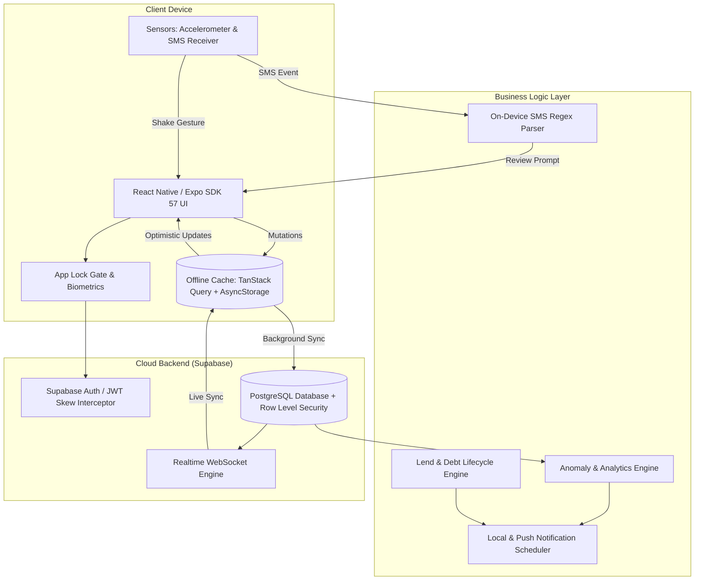

# 📱 PocketWise — Intelligent Personal Wealth & Finance Tracker

<p align="center">
  
</p>

<p align="center">
  <strong>A modern, offline-first personal finance platform built for speed, privacy, and proactive wealth management.</strong>
</p>

<p align="center">
  
  
  
  
  
  
  
  
  
</p>

---

## 🌟 Executive Overview

**PocketWise** is a production-grade, privacy-first personal wealth management and expense tracking mobile application designed for modern mobile workflows. Built with **React Native (Expo SDK 57)** and **Supabase**, PocketWise transforms reactive expense logging into an automated, proactive financial assistant through **on-device SMS parsing**, **accelerometer-triggered shake-to-log**, **real-time anomaly detection**, **debt/lending lifecycle management**, and **zero-latency offline caching**.

---

## 🚀 Key Product Features

### 1. 📊 Real-Time Financial Dashboard & Net Worth
- **Comprehensive Wealth Overview**: Aggregated live net worth across liquid bank accounts, cash wallets, credit cards, and investments.
- **Monthly Cash Flow**: Real-time income vs. expense tracking with month-over-month trajectory indicators.
- **Category Spend Distribution**: Visual distribution breakdown identifying major spending drains instantly.
- **Recent Activity Ledger**: Chronological transaction feed with instant filtering by bank, category, or payment method.

### 2. 📩 Automated Bank SMS Transaction Ingestion (Zero-Friction)
- **Native Android SMS Broadcast Listener**: Automatically captures incoming debit/credit transaction SMS notifications from major Indian & international banks (HDFC, SBI, ICICI, Axis, Kotak, PNB, Paytm, and more).
- **100% On-Device Parsing Engine**: High-accuracy regex extraction for amount, transaction type (Debit/Credit), merchant/beneficiary, and account reference numbers. Sensitive SMS data **never** leaves the device.
- **Review & Approval Gate**: Streamlined bottom-sheet modal allowing users to confirm, categorize, and link extracted transactions to existing accounts with a single tap.

### 3. 📳 Shake-to-Log (Hardware Gesture Capture)
- **Instant Gesture Entry**: Physical accelerometer shake gesture triggers the **Quick Expense Modal** from anywhere in the app without unlocking or navigating menus.
- **Configurable Sensitivity & Cooldowns**: Adjustable G-force thresholds and debounce windows to prevent accidental pocket triggers.
- **Haptic Feedback**: High-precision haptic pulses confirming gesture recognition and submission.

### 4. 🤝 Lending & Debt Lifecycle Management ("Lends")
- **Dual-Sided Tracking**: Separate ledgers for money lent to others (*You Lent*) and money borrowed (*You Borrowed*).
- **Dynamic "Amount to Collect" Tracking**: Track original principal versus remaining receivable balance as partial repayments occur.
- **Editable Repayments**: Quick in-line modal to record partial settlements or adjust outstanding collection targets.
- **Follow-Up Reminders & Rescheduling**: Automatically schedules local push notifications at 9:00 AM on due dates, with quick-preset rescheduling (+1 Week, +2 Weeks, +1 Month, or custom date picker).

### 5. 🔔 Proactive Intelligence & Notification Engine
- **Unusual Spending Anomaly Detection**: Automatically flags transactions exceeding 2.5× the historical category moving average.
- **Budget Threshold Alerts**: Proactive notifications when category spending crosses 80% and 100% of defined budget caps.
- **Recurring Bill & Subscription Reminders**: Automated reminders for upcoming due dates with one-tap "Mark as Paid" action.
- **Smart Deduplication**: Suppresses redundant alert notifications within configurable cooldown windows.

### 6. ⚡ Zero-Latency Offline-First Architecture
- **7-Day Persistent Cache**: Powered by **TanStack Query** + **AsyncStorage Persister** for instant cold boots and seamless offline usage.
- **Optimistic UI Updates**: All actions (adding expenses, transferring funds, editing budgets) update the UI instantaneously and sync with Supabase in the background.
- **PostgreSQL Real-Time Subscriptions**: Multi-device sync over WebSockets whenever the network is reachable.
- **Clock-Drift Resilient Auth**: Built-in JWT clock skew interceptor automatically retries and handles token edge cases without logging users out.

### 7. 🔒 Biometric Security & App Lock Gate
- **Multi-Factor Protection**: 4-digit master PIN lock combined with native **Biometrics (Face ID / Fingerprint)** via `expo-local-authentication`.
- **Encrypted Credential Storage**: Uses `expo-secure-store` for cryptographic key and PIN hash persistence.
- **Deep-Link Privacy Gate**: Holds pending notification routes securely in memory until authentication is verified.

### 8. 📑 Financial Analytics & Statement Export
- **Dynamic Time Filters**: Switch between predefined views (Today, This Week, This Month, Last Month, This Year) or custom date ranges.
- **Savings Rate Benchmarking**: Calculates savings efficiency percentage and month-over-month trajectory.
- **Data Export**: Export itemized statements as formatted **CSV** spreadsheets or comprehensive text summaries.

---

## 🏗️ Architecture Overview



---

## 🛠️ Technology Stack

| Layer | Technology | Purpose |
|---|---|---|
| **Framework** | [Expo SDK 57](https://expo.dev) / React Native 0.86 | Native mobile cross-platform runtime |
| **Routing** | [Expo Router v57](https://docs.expo.dev/router/introduction/) | Typed file-system navigation & deep-linking |
| **State & Cache** | [TanStack React Query v5](https://tanstack.com/query) | Server state management, optimistic UI & offline persistence |
| **Backend & DB** | [Supabase](https://supabase.com) (PostgreSQL) | Authentication, Database, Row Level Security (RLS) & Realtime |
| **Styling** | [NativeWind v4](https://www.nativewind.dev) / Tailwind CSS | Performant, utility-first styling system |
| **Icons & UI** | [Lucide React Native](https://lucide.dev) | Modern minimalist iconography |
| **Sensors & Hardware**| `expo-sensors`, `expo-haptics`, `expo-local-authentication` | Accelerometer gestures, haptic feedback, biometrics |
| **Notifications** | `expo-notifications`, `@react-native-firebase/messaging` | Local scheduled triggers and cloud push notifications |
| **Quality & Tests** | [Jest](https://jestjs.io), TypeScript 6.0 | Unit & integration test suites, strict static typing |

---

## 📐 Financial Precision: Minor Unit Arithmetic

To eliminate floating-point precision rounding errors common in JavaScript (e.g., `0.1 + 0.2 = 0.30000000000000004`), all monetary values throughout PocketWise are calculated, stored, and persisted in **minor currency units (cents / paise)**:
- `₹1,250.50` is stored internally as integer `125050`.
- All database aggregations, budget limits, and analytics use exact integer math.
- Dedicated formatting utilities (`formatMoney`, `parseMoneyToMinor`) handle seamless display conversion.

---

## 📁 Directory Structure

```
PocketWise/
├── app/                          # Expo Router routes
│   ├── (auth)/                   # Authentication screens
│   │   ├── login.tsx             # Sign-in flow
│   │   └── register.tsx          # Account registration
│   ├── (tabs)/                   # Floating bottom tab navigation
│   │   ├── index.tsx             # Dashboard & Net Worth
│   │   ├── transactions.tsx      # Transaction feed & filters
│   │   ├── subscriptions.tsx     # Recurring subscriptions
│   │   ├── budgets.tsx           # Monthly category budgets
│   │   └── more.tsx              # Settings & financial hubs
│   ├── _layout.tsx               # Root app layout & global providers
│   ├── bills.tsx                 # Bill reminders & tracking
│   ├── goals.tsx                 # Savings goals tracker
│   ├── lends.tsx                 # Debt & lending ledger
│   ├── reports.tsx               # Financial analytics & export
│   ├── shake-settings.tsx        # Shake gesture configuration
│   └── notification-settings.tsx # Push & alert preferences
├── components/                   # UI components
│   ├── ui/                       # Design system (AppModal, Button, Card, Input)
│   ├── AppLockGate.tsx           # Biometric & PIN gatekeeper
│   ├── CustomBottomTabBar.tsx    # Floating navigation bar
│   ├── QuickExpenseModal.tsx     # Accelerometer-triggered logger
│   ├── RecordTransactionModal.tsx# Transaction entry modal
│   └── SmsTransactionReviewModal.tsx # SMS parsing review dialog
├── lib/                          # Core domain services
│   ├── finance/                  # Financial math & analytics engine
│   ├── notifications/            # Local scheduler, push & deep linking
│   ├── security/                 # App lock & cryptographic services
│   ├── services/                 # Supabase CRUD services (accounts, lends, etc.)
│   ├── shake/                    # Accelerometer gesture service
│   ├── sms/                      # Native Android SMS parser
│   └── supabase.ts               # Supabase client with retry interceptor
├── android/                      # Native Android project configuration
├── __tests__/                    # Comprehensive test suite (54+ tests)
├── assets/                       # App icons, splash screens, and illustrations
├── global.css                    # Tailwind CSS definitions
└── package.json                  # Dependencies and build scripts
```

---

## 🚦 Getting Started

### Prerequisites
- **Node.js**: `v20.x` or higher
- **npm** or **bun** / **yarn**
- **Android Studio** with Android SDK (API 34+) for Android builds
- **Xcode** (macOS only) for iOS builds

### 1. Clone the Repository
```bash
git clone https://github.com/PannagaJA/PocketWise.git
cd PocketWise
```

### 2. Install Dependencies
```bash
npm install
```

### 3. Configure Environment Variables
Create a `.env` file in the project root:
```env
EXPO_PUBLIC_SUPABASE_URL=https://your-project.supabase.co
EXPO_PUBLIC_SUPABASE_ANON_KEY=your-supabase-anon-key
```

### 4. Start Local Development
```bash
# Start Metro bundler with cache reset
npx expo start -c

# Run on connected Android device / emulator
npm run android

# Run on iOS simulator
npm run ios
```

---

## 📦 Building Standalone APK (Android)

### Method A: Local Gradle Build (Fastest, Completely Offline)
To build a standalone Release APK locally on your computer:

```bash
# 1. Set environment variables (macOS example)
export JAVA_HOME="/Applications/Android Studio.app/Contents/jbr/Contents/Home"
export ANDROID_HOME="$HOME/Library/Android/sdk"

# 2. Build Release APK
cd android && ./gradlew assembleRelease
```

The APK will be generated at:
```text
android/app/build/outputs/apk/release/app-release.apk
```

Install directly to a connected Android device:
```bash
adb install -r android/app/build/outputs/apk/release/app-release.apk
```

### Method B: EAS Local Build
```bash
npx eas-cli build --platform android --profile preview --local
```

### Method C: EAS Cloud Build
```bash
npx eas-cli build --platform android --profile preview
```

---

## 🧪 Testing & Quality Assurance

PocketWise maintains comprehensive test coverage across financial calculation engines, notification deduplication algorithms, SMS regex parsing, and security services:

```bash
# Run unit & integration test suite
npm test

# Run TypeScript static analysis
npx tsc --noEmit
```

### Test Coverage Highlights:
- **Finance Engine (`__tests__/finance.test.ts`)**: Minor unit conversion, balance calculations, net worth aggregates.
- **SMS Parser (`__tests__/smsParser.test.ts`)**: Regex verification across 20+ major bank SMS message formats.
- **Notification Engine (`__tests__/notifications.test.ts`)**: Anomaly detection thresholds (2.5×), budget limits, deduplication cooldowns.
- **Shake Gesture (`__tests__/shakeService.test.ts`)**: Acceleration threshold calculations and debounce timers.
- **Security & App Lock (`__tests__/stage5_security.test.ts`)**: PIN hashing, verification, biometric fallbacks.
- **Financial Reports (`__tests__/stage6_reports.test.ts`)**: Cash flow projections, savings rate algorithms.

---

## 🔐 Privacy & Security Architecture

- **Row Level Security (RLS)**: PostgreSQL database enforces strict RLS policies, ensuring each user's financial ledger is strictly isolated.
- **Zero Cloud SMS Exposure**: SMS parsing runs 100% on-device in native code. Raw messages are never uploaded to any external server.
- **Hardware Enclave Key Storage**: Master PIN hashes and biometric keys are stored in encrypted hardware keystores via `expo-secure-store`.
- **Encrypted Data in Transit**: All network requests to Supabase use HTTPS/TLS 1.3 with cryptographic JWT authentication.

---

## 📄 License

This project is licensed under the **MIT License** — see the [LICENSE](LICENSE) file for details.

<p align="center">
  Crafted with precision for modern personal wealth management.
</p>
